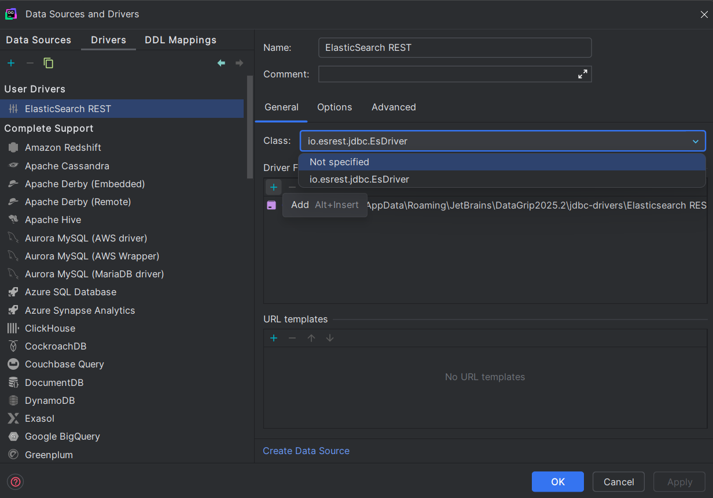
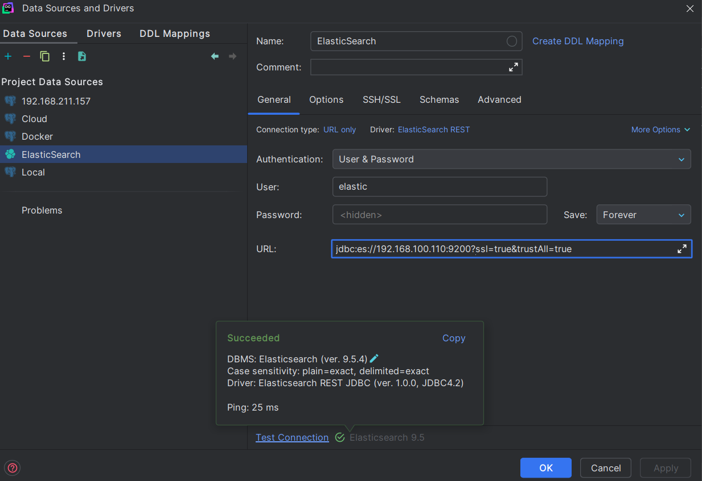
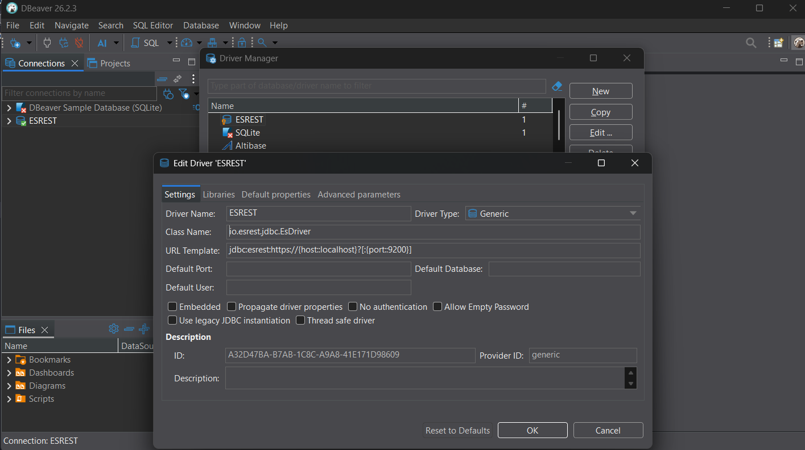
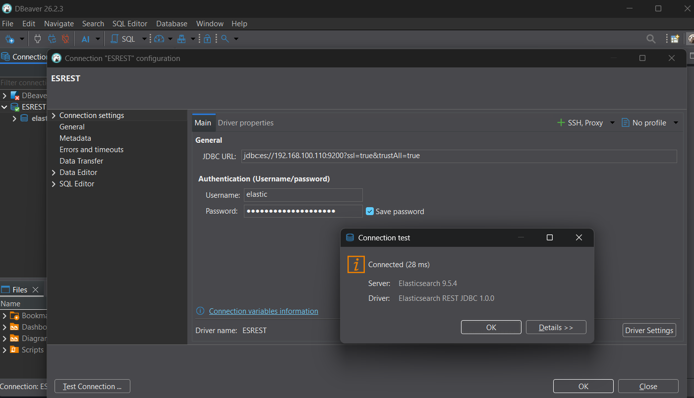

# Elasticsearch REST JDBC Driver for DataGrip

[](LICENSE)

**Connect DataGrip to Elasticsearch without a Platinum license.** This is a free JDBC driver built first and foremost
for **JetBrains DataGrip** (and the database tools in IntelliJ IDEA, PyCharm, WebStorm, ...). Use it to browse indices,
see every document with its `_id`, sort and filter, run SQL and aggregations, and edit documents.

It talks to Elasticsearch over plain **HTTP REST** (`POST /_sql`, `POST /_search`, ...), the same API you call with
`curl`. This is **not the official Elasticsearch JDBC driver** (`x-pack-sql-jdbc`): it is an independent, community-made
alternative that doesn't use any Elastic code. DataGrip is the primary target. It has also been tested with
[DBeaver](#setting-up-dbeaver) and works with any other JDBC tool.

**Free and open source** under the [MIT License](#license): use it, modify it and share it, including at work and in
commercial products, at no cost.

**Download:** get `esrest-<version>.jar` from the [latest release](../../releases/latest), or [build it yourself](#build).

## Why?

The official JDBC driver (`x-pack-sql-jdbc`) sends requests in `mode=jdbc`. Elasticsearch accepts that mode only when the
cluster has a **Platinum/Enterprise** license.

The REST endpoints this driver uses (`/_sql` in `plain` mode, `/_search`, `/_field_caps`, the document APIs) are all part
of the free **Basic** license. The driver calls them over HTTP/JSON and turns the responses into JDBC `ResultSet`s.

```
DataGrip ──JDBC──▶ esrest-1.0.0.jar ──HTTP/JSON──▶ Elasticsearch REST API
                                         POST /_sql?format=json     SQL queries, COUNT, GROUP BY (cursor paging)
                                         POST /_sql/translate       WHERE / ORDER BY → query DSL (only when present)
                                         GET  /<index>/_field_caps  columns of the document view (cached 60 s)
                                         POST /<index>/_search      document view (rows with _id)
                                         _update_by_query, _delete_by_query, _doc, _create   edits
```

## Features

- **Document view with `_id`.** Opening an index in DataGrip shows every document with its `_id` as the first column.
  `_id` is the primary key, so edits and deletes target exactly one document.
- **Sort and filter by column.** Clicking a column header or typing a filter in DataGrip becomes `ORDER BY` / `WHERE`,
  which Elasticsearch translates into a real `sort` and `query`. Text fields sort by their `.keyword` sub-field.
- **Objects as JSON.** Objects are flattened into `a.b` columns up to two levels. Anything deeper, and `nested` fields,
  is shown as a JSON cell you can read and edit. See [Type mapping](#type-mapping) for details.
- **Full Elasticsearch SQL.** `COUNT(*)`, `SUM` / `AVG` / `MIN` / `MAX`, `GROUP BY`, `HAVING`, many conditions with
  `AND` / `OR` / `IN` / `BETWEEN` / `LIKE`, and full-text `MATCH()` / `QUERY()` with `SCORE()`. Large results page
  through the SQL cursor.
- **Editing.** `INSERT` / `UPDATE` / `DELETE`, including editing cells in the DataGrip grid. `_id` is optional on insert.
  A safety limit decides how many documents one statement may change.
- **Raw REST in the console.** `GET /_cat/indices`, `POST /idx/_search { ... }`, and so on. Search hits, aggregation
  buckets, `_count` and other responses are shown as tables.
- **Database Explorer tree.** Indices show up as tables and aliases as views, with their columns. The cluster name is
  the catalog.
- **Connection.** Basic auth or an API key. HTTPS with a custom CA or `trustAll` for self-signed clusters.
- **Lightweight.** No dependencies. A single jar of about 90 KB that runs on Java 11+.

## Setting up DataGrip

### 1. Create the driver

1. Open **Data Sources and Drivers**, go to the **Drivers** tab and click **`+` → User Driver**. Don't pick the built-in
   *Elasticsearch* driver: it uses the official jar, which requires a license.
2. Name it `Elasticsearch REST`.
3. Under **Driver Files**, click **`+` → Custom JARs…** and select `esrest-1.0.0.jar`.
4. Set **Class** to `io.esrest.jdbc.EsDriver`.
5. Optionally, under **URL templates**, click **`+`** and add one named `default` with this template:
   ```
   jdbc:esrest:https://{host::localhost}?[:{port::9200}][\?<&,{:identifier}={:param}>]
   ```
6. Click **Apply**.



### 2. Create the data source

1. Click **Create Data Source** (or **Data Sources → `+`**) and pick the `Elasticsearch REST` driver.
2. Set **Authentication** to **User & Password** and enter the user and password.
3. Enter the URL, for example `jdbc:es://localhost:9200?ssl=true&trustAll=true`.
4. Click **Test Connection**. On success, DataGrip reports the cluster version and
   `Driver: Elasticsearch REST JDBC (ver. 1.0.0, JDBC4.2)`.



If the cluster uses a self-signed certificate (the default in ES 8), set `trustAll=true` on the data source's
**Advanced** tab, or point `caCertPath` at the cluster's CA file.

**Alternative:** this driver also accepts the official `jdbc:es:` prefix. You can therefore edit the built-in
*Elasticsearch* driver instead: replace its Driver Files with this jar, set the Class to `io.esrest.jdbc.EsDriver`, and
use a URL such as `jdbc:es://host:9200/?ssl=true&trustAll=true`.

## Setting up DBeaver

### 1. Create the driver

1. Open **Database → Driver Manager** and click **New**.
2. On the **Settings** tab:
   - **Driver Name:** `ESREST`
   - **Driver Type:** `Generic`
   - **Class Name:** `io.esrest.jdbc.EsDriver`
   - **URL Template:** `jdbc:esrest:https://{host::localhost}?[:{port::9200}]`
3. On the **Libraries** tab, click **Add File** and select `esrest-1.0.0.jar`.
4. Click **OK**.



### 2. Create the connection

1. Click **New Database Connection** and pick the `ESREST` driver.
2. On the **Main** tab, enter the **JDBC URL**, for example `jdbc:es://localhost:9200?ssl=true&trustAll=true`.
3. Enter the **Username** and **Password**.
4. Click **Test Connection**. On success, DBeaver shows the server version and `Driver: Elasticsearch REST JDBC 1.0.0`.



## Basic operations

Open an index from the Database Explorer to get the document view, or open a console and try:

```sql
-- Browse documents (document view: _id + all fields)
SELECT * FROM "my-index" WHERE status = 'open' ORDER BY "@timestamp" DESC LIMIT 20;
SELECT * FROM "my-index" WHERE _id = 'doc-1';

-- Insert: give an _id, or leave it out (or use DEFAULT / NULL) and Elasticsearch generates one
INSERT INTO "my-index" (_id, status, owner.name) VALUES ('doc-1', 'open', 'alice');
INSERT INTO "my-index" (status, owner.name) VALUES ('open', 'bob');

-- Update and delete by _id (exactly what DataGrip sends when you edit the grid)
UPDATE "my-index" SET status = 'closed', owner.address = '{"city": "Hanoi"}' WHERE _id = 'doc-1';
DELETE FROM "my-index" WHERE _id = 'doc-1';
```

In the data grid, double-click a cell to edit it, use **+** / **−** to add or remove rows, and click **Submit**
(Ctrl+Enter). Click a column header to sort, and use the **WHERE** box above the grid to filter.

## Type mapping

How each Elasticsearch field type appears in DataGrip:

| Elasticsearch type | JDBC type | Example `_source` value | Shown in DataGrip |
|---|---|---|---|
| `keyword`, `constant_keyword`, `wildcard` | `VARCHAR` | `"open"` | `open` |
| `text`, `match_only_text` | `VARCHAR` | `"Disk is full"` | `Disk is full` (sorting and `=` use `.keyword` when it exists) |
| `long` | `BIGINT` | `42` | `42` |
| `integer` / `short` / `byte` | `INTEGER` / `SMALLINT` / `TINYINT` | `7` | `7` |
| `unsigned_long` | `NUMERIC` | `18446744073709551615` | `18446744073709551615` |
| `double`, `scaled_float` | `DOUBLE` | `9.8` | `9.8` |
| `float` / `half_float` | `REAL` / `FLOAT` | `0.5` | `0.5` |
| `boolean` | `BOOLEAN` | `true` | `true` |
| `date`, `date_nanos` | `TIMESTAMP` | `"2024-05-01T10:20:30Z"` | `2024-05-01 17:20:30` (shown in DataGrip's time zone, here UTC+7) |
| `ip`, `version` | `VARCHAR` | `"10.0.0.1"` | `10.0.0.1` |
| `binary` | `VARBINARY` | `"aGVsbG8="` (base64) | bytes `hello` |
| `object`, within 2 levels | one column per field | `"user": {"name": "alice"}` | column `user.name` = `alice` |
| `object`, deeper than 2 levels | `OTHER` (JSON) | `"user": {"address": {"city": "HN"}}` | column `user.address` = `{"city":"HN"}` |
| `nested` | `OTHER` (JSON) | `"comments": [{"text": "hi"}]` | column `comments` = `[{"text":"hi"}]` |
| `geo_point`, `geo_shape`, `flattened` | `OTHER` / `VARCHAR` (JSON) | `{"lat": 21.0, "lon": 105.8}` | `{"lat":21.0,"lon":105.8}` |
| array of values | element type | `"tags": ["a", "b"]` / `"tags": ["a"]` | `["a","b"]` / `a` |
| document id | `VARCHAR` (primary key) | `_id` of the hit | first column `_id` |

### Example: one document in the grid

This document in index `tickets`:

```json
{
  "_id": "T-1001",
  "@timestamp": "2024-05-01T03:00:00Z",
  "title": "Login fails",
  "status": "open",
  "user": { "name": "alice", "address": { "city": "Hanoi", "zip": "100000" } },
  "comments": [ { "by": "bob", "text": "Looking into it" } ],
  "tags": ["auth", "urgent"]
}
```

appears like this when you open `tickets` in DataGrip (columns are sorted by name, `_id` comes first):

| _id | @timestamp | comments | status | tags | title | user.address | user.name |
|---|---|---|---|---|---|---|---|
| T-1001 | 2024-05-01 10:00:00 | `[{"by":"bob","text":"Looking into it"}]` | open | `["auth","urgent"]` | Login fails | `{"city":"Hanoi","zip":"100000"}` | alice |

Here is how the parts of the document map to columns:

- `user` is an object, so its fields become the columns `user.name` and `user.address`.
- `user.address` is at the depth limit (2 levels), so it is shown as JSON.
- `comments` is a `nested` field, so it is always JSON.
- `title.keyword` (a multi-field) is hidden, because it is the same value as `title`.

Editing a JSON cell, e.g. changing `user.address` to `{"city":"Da Nang"}`, writes it back as an object.

### Which view runs, and when

| Query | How it runs | `_id` column |
|---|---|---|
| `SELECT * FROM idx [WHERE ...] [ORDER BY ...]` with a row limit: `LIMIT n`, or the JDBC max rows that DataGrip's grid page size sets | **Document view**: `_sql/translate` + `_search` | yes |
| Explicit columns, functions, `COUNT`, `GROUP BY`, `HAVING`, `SHOW`, `DESCRIBE`, ... | **ES SQL** (`/_sql`, paged by cursor) | no |
| `GET /...`, `POST /...`, ... | **Raw REST** | as returned |

The document view reads up to 10,000 rows per query (Elasticsearch's default `index.max_result_window`). Larger
`SELECT *` without a limit runs as ES SQL instead.

### Performance

Showing `_id` costs nothing: every `_search` hit already contains it. What the document view adds are two lightweight
calls that read no documents, and the driver avoids them when it can:

| Action in DataGrip | Requests |
|---|---|
| Open an index (no filter, no sort) | `_search` only; `_field_caps` the first time, then from the cache |
| Sort a column or type a filter | `_sql/translate` (parses the SQL, no data read) + `_search` |
| Scroll to the next page | `_search` with the next `from` (no translate, mapping from the cache) |
| Filter only by `_id` | `_search` with an `ids` query (no translate) |

- The mapping (`_field_caps`) is cached per connection for 60 seconds and dropped after every `INSERT`/`UPDATE`/`DELETE`,
  so new fields show up right away.
- Without `ORDER BY`, documents come in index order (`_doc`), the cheapest order to page through.
- `from`/`size` paging gets slower the deeper you scroll and stops at 10,000 rows. For large exports, select explicit
  columns (`SELECT a, b, c FROM idx`); that runs as ES SQL with cursor paging and has no such limit.

## Query examples

```sql
-- Count, aggregations, many conditions (ES SQL)
SELECT COUNT(*) FROM "logs-*" WHERE level = 'ERROR';

SELECT level, COUNT(*) AS total, AVG(duration_ms) AS avg_ms, MAX("@timestamp") AS last_seen
FROM "logs-*"
WHERE "@timestamp" > NOW() - INTERVAL 1 DAY
  AND (level IN ('ERROR', 'WARN') OR service LIKE 'auth%')
  AND duration_ms BETWEEN 100 AND 5000
GROUP BY level
HAVING COUNT(*) > 10
ORDER BY total DESC;

SELECT HISTOGRAM("@timestamp", INTERVAL 1 HOUR) AS hour, COUNT(*) FROM "logs-*" GROUP BY hour;

-- Full-text search with relevance
SELECT message, SCORE() FROM "logs-*" WHERE MATCH(message, 'timeout') ORDER BY SCORE() DESC LIMIT 50;

-- Document view: sort, filter, and look up by _id
SELECT * FROM "logs-2024.10" WHERE level = 'ERROR' ORDER BY "@timestamp" DESC LIMIT 100;
SELECT * FROM "logs-2024.10" WHERE _id IN ('a1', 'b2', 'c3');
```

Index names that contain `-`, `.` or `*` must be quoted with double quotes (`"..."`).

### Raw REST passthrough

A statement that starts with `GET|POST|PUT|DELETE|HEAD /path` is sent to the REST API as-is. The request body, if any,
goes after the first line:

```
GET /_cat/indices?format=json

GET /my-index/_count

POST /logs-*/_search
{ "query": { "match": { "message": "timeout" } }, "size": 50 }

POST /logs-*/_search
{ "size": 0, "aggs": { "by_level": { "terms": { "field": "level" }, "aggs": { "avg_ms": { "avg": { "field": "duration_ms" } } } } } }
```

How each kind of response becomes a table:

| Response | Table |
|---|---|
| `_search` with hits | one row per hit: `_index`, `_id`, `_score`, then the `_source` fields |
| `_search` with `aggs` (and `"size": 0`) | one row per bucket: `aggregation`, `key`, `doc_count`, then each sub-aggregation's value |
| JSON array (`_cat/...?format=json`) | one row per element |
| JSON object (`_count`, `_cluster/health`, ...) | a single row, one column per field (nested objects as JSON) |
| plain text (`_cat/...?v`) | one row per line |

For example, the `aggs` request above returns something like:

| aggregation | key | doc_count | avg_ms |
|---|---|---|---|
| by_level | INFO | 9120 | 35.2 |
| by_level | ERROR | 311 | 812.4 |

> ⚠️ `PUT`/`DELETE` change real data on the cluster, and the `maxAffectedDocs` guard does **not** apply to raw REST. If
> you only need to read, connect with a read-only user.

## Editing data

ES SQL is read-only, so the driver turns DML statements into document API calls:

| Statement | Elasticsearch call |
|-----------|--------------------|
| `UPDATE idx SET a = ?, b.c = 'x' WHERE _id = ?` | `POST /idx/_update_by_query` with an `ids` query and a painless script that sets the fields |
| `UPDATE idx SET a = ? WHERE status = 'open'` | the same, with the `WHERE` translated by `POST /_sql/translate` |
| `DELETE FROM idx WHERE _id = ?` | `POST /idx/_delete_by_query` |
| `INSERT INTO idx (_id, a) VALUES ('x', ?)` | `PUT /idx/_create/x` |
| `INSERT INTO idx (a, b) VALUES (?, ?)` (no `_id`, or `_id` = `DEFAULT` / `NULL`) | `POST /idx/_doc` (Elasticsearch generates the id) |

How it stays safe:

- `_id = value` and `_id IN (...)` become an exact `ids` query. All other conditions are converted to query DSL by
  Elasticsearch itself, so they have exactly the semantics of an ES SQL `WHERE`.
- Before an `UPDATE`/`DELETE`, the driver counts the matching documents (`_count`). If more than `maxAffectedDocs`
  (default **1**) match, it refuses the statement and **changes nothing**. `max_docs` is also sent as a second guard.
  To change many documents on purpose, set `maxAffectedDocs` higher on the data source.
- `readOnly=true`, or DataGrip's **Read-only** data source option, blocks every write.
- Writes use `refresh=true`, so DataGrip shows the change right after you submit.

Things to know:

- `SET` values must be literals or `?` parameters. Expressions such as `a = a + 1` aren't supported.
- Dotted names (`owner.address.city`) update nested objects. JSON text (`'{"city":"Hanoi"}'`, `'["a","b"]'`) is written
  back as an object or array.
- A document's `_id` can't be changed. Insert a new document and delete the old one instead.
- With the ES SQL view (no `_id` column), DataGrip falls back to a `WHERE` that matches every column. Use the document
  view (open the index) for grid edits.

## URL and properties

```
jdbc:esrest://host:9200                          # http (port defaults to 9200)
jdbc:esrest://host:9200?ssl=true                 # https
jdbc:esrest:https://es.example.com               # explicit scheme (port defaults to 443)
jdbc:esrest:https://gateway.example.com/es       # ES behind a reverse proxy with a path prefix
jdbc:esrest://host:9200?user=elastic&password=xxx&timezone=Asia/Ho_Chi_Minh
jdbc:es://host:9200/?ssl=true                    # official driver prefix, also accepted
```

Connection properties (the DataGrip **Advanced** tab) override URL parameters of the same name.

| Property                  | Default  | Description |
|---------------------------|----------|-------------|
| `user` / `password`       |          | Basic auth credentials |
| `apiKey`                  |          | Base64 API key (`id:api_key`), sent as `Authorization: ApiKey …`. Takes precedence over user/password |
| `ssl`                     | `false`  | Use `https` when the URL has no scheme |
| `caCertPath`              |          | PEM CA certificate, e.g. `config/certs/http_ca.crt` on ES 8 |
| `trustAll`                | `false`  | Accept any certificate and skip host name verification (development only) |
| `timezone`                | `Z`      | Time zone ES SQL uses for date/time functions and output, e.g. `Asia/Ho_Chi_Minh` |
| `fetchSize`               | `1000`   | Rows per page |
| `connectTimeout`          | `10000`  | Connect timeout (ms) |
| `readTimeout`             | `300000` | Read timeout (ms) |
| `fieldMultiValueLeniency` | `true`   | ES SQL view: for array fields, return the first value instead of failing |
| `readOnly`                | `false`  | Reject all `INSERT/UPDATE/DELETE` |
| `maxAffectedDocs`         | `1`      | Maximum documents a single `UPDATE`/`DELETE` may change. If more match, the statement is refused and nothing changes |

## Minimum user privileges

```json
{
  "cluster": ["monitor"],
  "indices": [{ "names": ["*"], "privileges": ["read", "view_index_metadata"] }]
}
```

`monitor` is optional. Without it the driver still connects, but it can't read the cluster name and version. To edit
data, also grant `write` on the indices (or `index` / `delete` for finer control).

## Troubleshooting

| Error | Cause / fix |
|-------|-------------|
| `Incorrect driver and/or database URL specified` | The data source is using a driver that doesn't accept the URL, usually DataGrip's built-in *Elasticsearch* driver. Switch the data source to the driver that contains this jar. |
| `Cannot POST address http://...` / `Unexpected end of file from server` | Plain `http` was sent to an `https` cluster. Use `jdbc:esrest:https://...` or add `ssl=true`. |
| `PKIX path building failed` | The cluster uses a self-signed certificate. Set `trustAll=true` or `caCertPath`. |
| `Connect timed out` | The host isn't reachable from this machine (check VPN/firewall): `Test-NetConnection <host> -Port 9200`. |
| `HTTP 401` | Wrong user/password or API key. |
| `HTTP 400: [verification_exception] ...` | Elasticsearch rejected the SQL. Check the message; for SQL that DataGrip generated, please open an issue with the query. |
| `Fielddata access on the _id field is disallowed` | Sorting by `_id` is disabled on ES 8 by default (`indices.id_field_data.enabled`). Sort by another column. |
| `UPDATE would affect N documents ... maxAffectedDocs=1` | The `WHERE` matches more than one document. Filter by `_id`, or raise `maxAffectedDocs` on purpose. |

To test a connection outside DataGrip, run `test/LiveTest.java` against your cluster. It prints the version, the
indices, a few columns and rows, and the cluster health, and it uses `trustAll=true`:

```bash
ES_URL='jdbc:esrest:https://host:9200' ES_USER=elastic ES_PASS='your-password' \
  java -cp esrest-1.0.0.jar test/LiveTest.java
```

## Limitations

- Writes support only the DML subset described in [Editing data](#editing-data). They aren't transactional: each
  statement is applied immediately, and *Rollback* doesn't undo it.
- The document view reads at most 10,000 rows per query (`from`/`size` paging). Use ES SQL for bigger exports.
- `ResultSet` is forward-only (`TYPE_FORWARD_ONLY`).
- ES SQL's own limits still apply to SQL queries: no JOINs, limited subqueries, limited support for `nested` fields
  (use the document view or raw REST for those).
- Requires Elasticsearch **7.x or later** (the `/_sql`, `/_sql/translate` and `_field_caps` endpoints). ES 6.x uses
  `/_xpack/sql` and isn't supported. It has been tested against a mock of the REST API; please report issues with real
  clusters.

## Build

Most people should simply download the jar from [Releases](../../releases/latest). Every release is built by
[GitHub Actions](#releases-github-actions).

To build it yourself, you need a full JDK 11+ (for `javac` and `jar`) and no build tool. From the project root, in bash
(Git Bash on Windows):

```bash
VERSION=1.0.0
mkdir -p build/classes dist
javac --release 11 -encoding UTF-8 -d build/classes $(find src -name '*.java')
cp -r src/META-INF build/classes/ && cp LICENSE build/classes/META-INF/
printf 'Manifest-Version: 1.0\nImplementation-Version: %s\n' "$VERSION" > build/MANIFEST.MF
jar --create --file "dist/esrest-$VERSION.jar" --manifest build/MANIFEST.MF -C build/classes .
```

These are the same steps the release workflow runs. The `Implementation-Version` line sets the driver version that
DataGrip shows.

Run the tests against a built-in mock of the Elasticsearch REST API (no cluster needed):

```bash
java -cp dist/esrest-1.0.0.jar test/MockEsTest.java     # prints ALL CHECKS PASSED, exit code 1 on failure
```

> DataGrip locks the jar while the driver is loaded, so a rebuild can't overwrite it. Close DataGrip before rebuilding,
> then reopen it so it loads the new jar.

## Releases (GitHub Actions)

[`.github/workflows/release.yml`](.github/workflows/release.yml) builds and tests the driver on every push and pull
request. When you publish a version, it also creates a **GitHub Release** with `esrest-<version>.jar` attached and
release notes generated from the commits.

There are two ways to publish a version:

- **Push a tag** (the version is taken from the tag name):
  ```bash
  git tag v1.0.0
  git push origin v1.0.0
  ```
- **From the GitHub UI**: go to **Actions → Build & Release → Run workflow** and enter a version such as `1.0.1`. The
  workflow creates the tag `v1.0.1` and the release.

The workflow runs on an Ubuntu runner with Temurin JDK 17. It compiles with `javac`, packages with `jar` (writing the
version into the manifest), runs `test/MockEsTest.java`, and doesn't publish anything if a test fails. Builds of `main` / `master`
and pull requests upload the jar as a workflow artifact only; they don't create a release.

> The workflow needs write access to the repository contents to create releases. It requests that itself
> (`permissions: contents: write`). If your organisation restricts the default `GITHUB_TOKEN`, allow it under
> **Settings → Actions → General → Workflow permissions**.

## Source layout

```
src/io/esrest/jdbc/
  EsDriver.java            java.sql.Driver, registers jdbc:esrest: (and jdbc:es:)
  EsConfig.java            URL and property parsing
  EsClient.java            HTTP client (HttpURLConnection, TLS, auth, ES error parsing)
  Json.java                Minimal JSON parser/writer (no dependencies)
  JdbcWrapper.java         Shared unwrap/isWrapperFor and "not supported" errors
  EsConnection.java        Connection; routes queries to the document view or ES SQL
  EsStatement.java         Statement; routes SQL / DML / raw REST
  EsPreparedStatement.java PreparedStatement -> "params"
  DocumentSearch.java      Document view: SELECT * -> _search with _id; translate + cached _field_caps
  IdCondition.java         Splits _id = ... / _id IN (...) out of WHERE (ES SQL has no _id)
  SqlTokens.java           Small SQL tokenizer shared by the parsers
  SqlRewriter.java         Rewrites tool-generated SQL for ES (t.* -> *)
  EsDml.java               INSERT/UPDATE/DELETE -> _doc / _create / _update_by_query / _delete_by_query
  RestResult.java          Raw REST responses (hits, aggregations, objects, text) -> tables
  PageSource.java          Paging: SQL cursor or _search from/size
  EsResultSet.java         Forward-only ResultSet
  EsResultSetMetaData.java
  EsDatabaseMetaData.java  Metadata via SYS TABLES/COLUMNS/TYPES, plus the _id primary key
  EsTypes.java, EsColumn.java
src/META-INF/services/java.sql.Driver
test/MockEsTest.java       Automated tests against an in-process mock of the ES REST API (used by CI)
test/LiveTest.java         Connection test against a real cluster
.github/workflows/release.yml  CI build, test and GitHub Release
LICENSE                    MIT License
```

## Keywords

DataGrip Elasticsearch driver · Elasticsearch JDBC driver free · Elasticsearch JDBC without Platinum license ·
Elasticsearch SQL JDBC · connect DataGrip to Elasticsearch · Elasticsearch REST JDBC · open source Elasticsearch JDBC ·
x-pack-sql-jdbc alternative · Elasticsearch basic license JDBC · IntelliJ Elasticsearch database · DBeaver Elasticsearch ·
Elasticsearch SQL client · Elasticsearch GUI · query Elasticsearch with SQL · edit Elasticsearch documents in DataGrip ·
Elasticsearch document _id in DataGrip · Elasticsearch aggregations SQL

Suggested GitHub topics (repository **About → ⚙ → Topics**):
`elasticsearch` `jdbc` `jdbc-driver` `datagrip` `elasticsearch-sql` `elasticsearch-jdbc` `intellij` `dbeaver`
`rest-api` `java` `database-tools` `sql`

## License

Released under the [MIT License](LICENSE). The project is free: you may use, copy, modify, merge, publish, distribute,
sublicense and sell copies of it, as long as the copyright and license notice are kept. The software is provided "as
is", without warranty of any kind.

*Elasticsearch is a trademark of Elasticsearch B.V. This project is an independent, community-made driver. It is not
affiliated with or endorsed by Elastic, and it doesn't contain any Elastic code.*
